# Portfolio 3: Transactions and Concurrency

**Case study:** MedConnect (online healthcare and telemedicine platform)

**Database:** PostgreSQL 18, database `medconnect`

## Overview

This portfolio demonstrates transaction control (COMMIT, ROLLBACK), a
concurrency problem (race condition), a control mechanism (row locking),
and isolation levels, all using the MedConnect schema.

## COMMIT (Booking an appointment) 
**Script:** `01_booking_commit.sql`

A booking is one transaction that does three things together: inserts a row in `consultation`, marks the slot as booked in `availability_slot`, and inserts a row in `payment`. `BEGIN` starts the unit and `COMMIT` saves all three changes at once (atomicity).

**Evidence:** After the `COMMIT`, a check query for slot 181702 returns one consultation (119538, Scheduled), `is_booked = true`, and one payment of 19,000.00 marked Paid. All three tables agree.

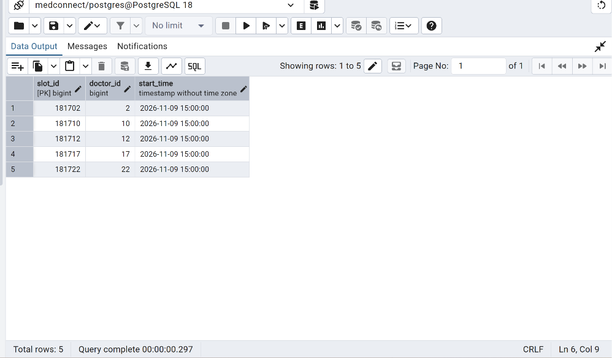
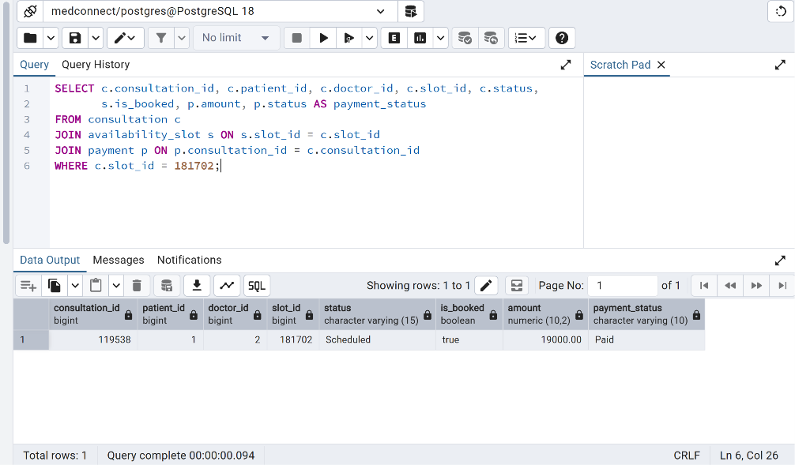

## ROLLBACK 
**Script:** `02_booking_rollback.sql`

This booking fails on purpose at the payment step: the payment method `'cash'` violates the `payment_method_check` constraint (SQL state 23514). Because the consultation insert and the slot update ran earlier in the same transaction, `ROLLBACK` undoes them too.

**Evidence:** After the failure, the check query for slot 181710 returns 0 consultations, `is_booked = false`, and 0 payments. This shows that nothing was left half-saved.

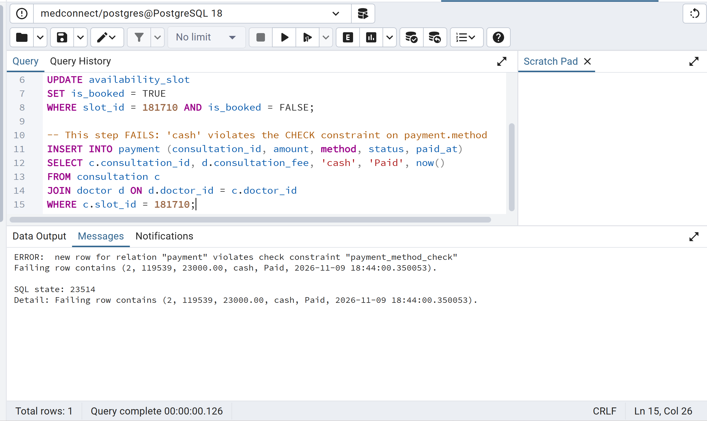
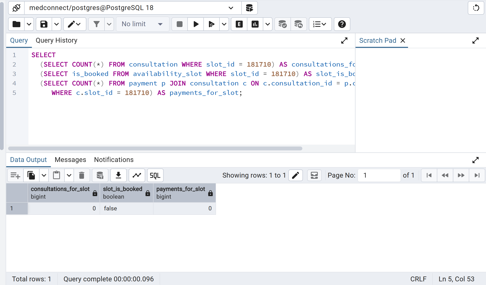

## Race condition (two sessions, same slot)
**Script:** `03_concurrency_race.sql`

Two sessions (pgAdmin Tab A and Tab B) try to book the same free slot at the same time. Both first check that the slot is free, and both see it as available. Tab A books it and commits. When Tab B then tries to insert its consultation for the same slot, the database rejects it with a duplicate key error.

**Why it matters:** Checking "is the slot free?" and then booking it are two separate steps. Between them, another session can take the slot (a race condition). Here, the unique constraint on `consultation.slot_id` is the last line of defence and stops a double booking, but Tab B only finds out after it has already done its work.

**Evidence:**

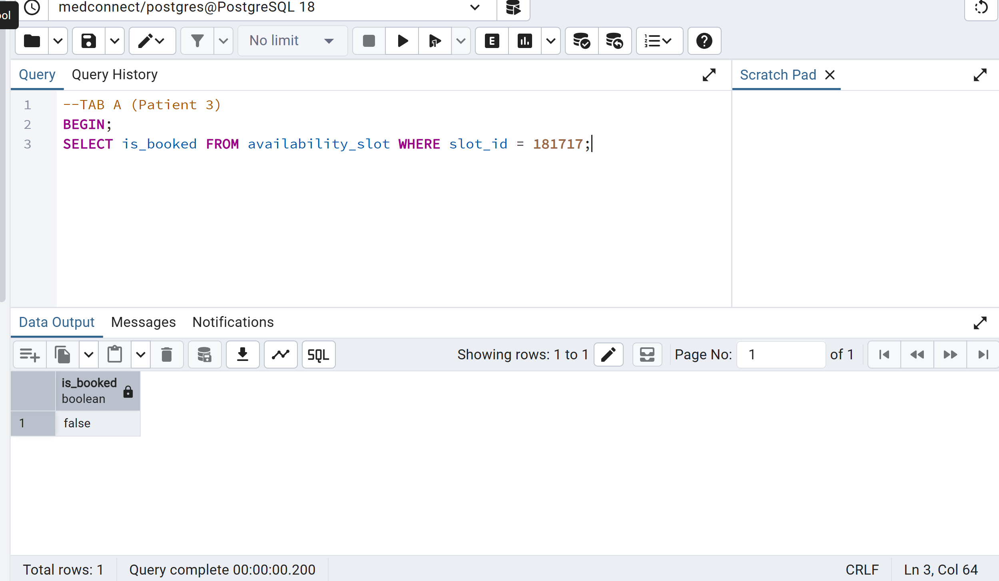
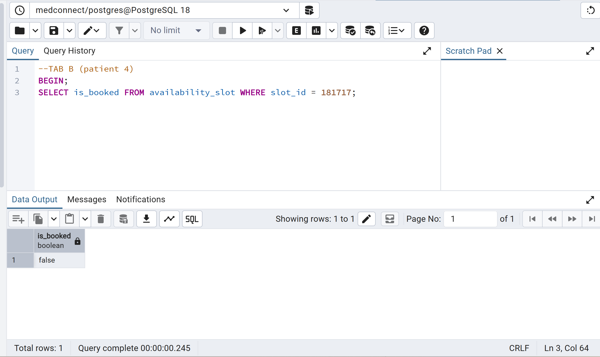
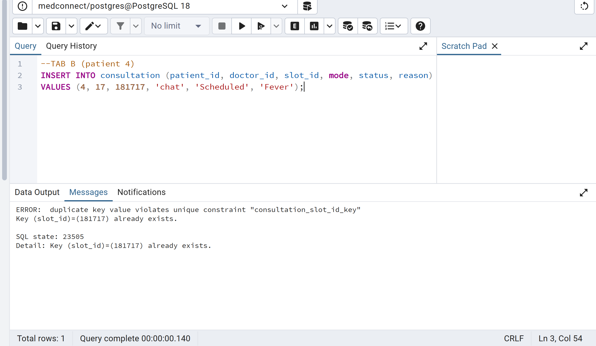
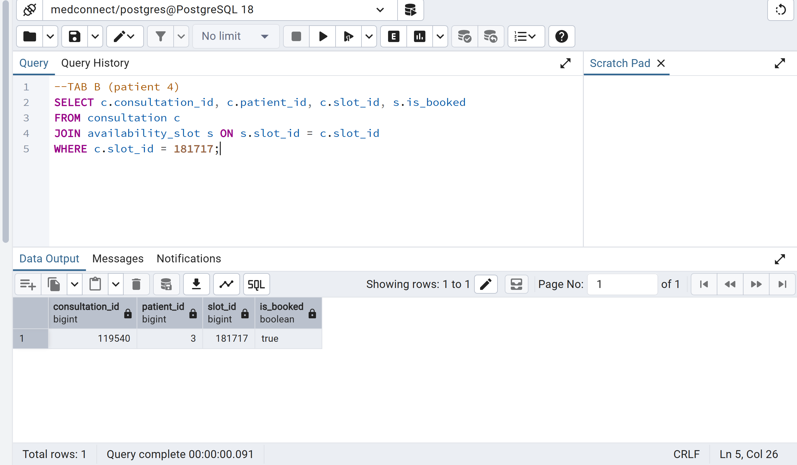

## Fixing the race with SELECT ... FOR UPDATE
**Script:** `04_concurrency_for_update.sql`

This fixes the race condition by locking the slot row. Tab A starts a transaction and runs `SELECT ... FOR UPDATE` on the free slot, which locks that row. When Tab B runs the same query for the same slot, it has to wait. After Tab A books the slot and commits, Tab B's query continues, re-checks `is_booked = FALSE`, and returns 0 rows. Tab B now knows the slot is gone and can stop cleanly, with no duplicate key error.

**Why it works:** The lock makes "check the slot" and "book the slot" behave as one step. Only one session at a time can work on that row.

**Evidence:**

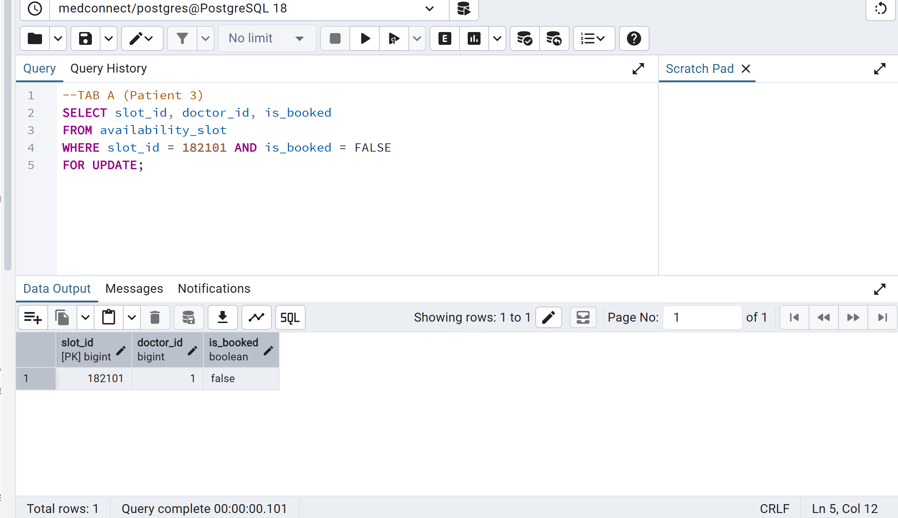
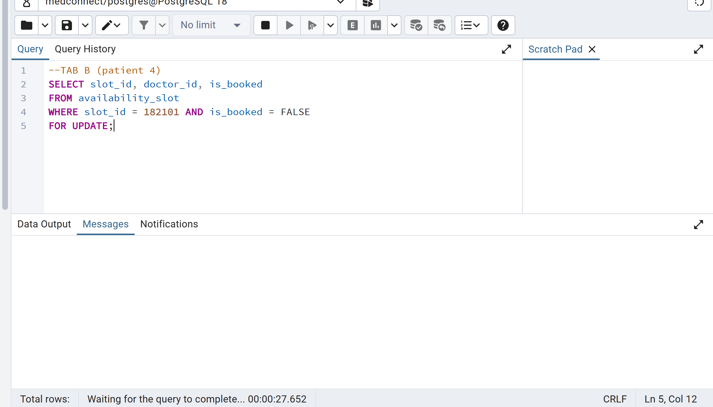
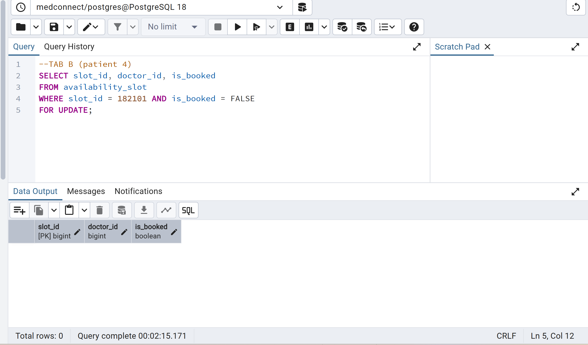
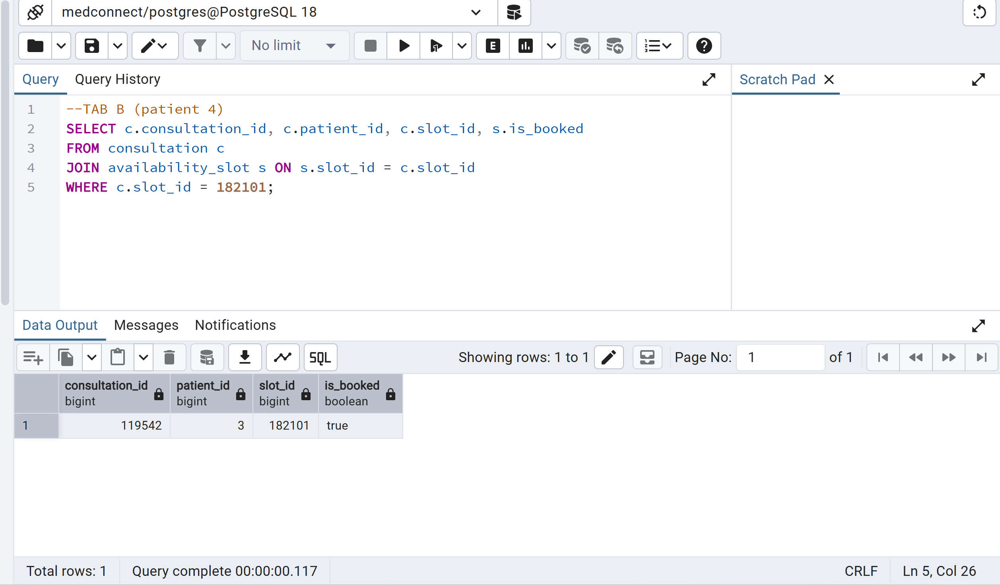

## Isolation levels (READ COMMITTED vs REPEATABLE READ)
**Script:** `05_isolation_levels.sql`

This level shows how the isolation level changes what a transaction sees when another session commits a change in the middle of it. Tab A reads doctor 1's consultation fee twice inside one transaction. Between the two reads, Tab B raises the fee by 1,000 and commits.

**Part 1: READ COMMITTED (the PostgreSQL default).** Tab A's first read returns 21,000.00. After Tab B commits its update, Tab A's second read in the same transaction returns 22,000.00. The same query gave two different answers inside one transaction. This is a *non-repeatable read*.

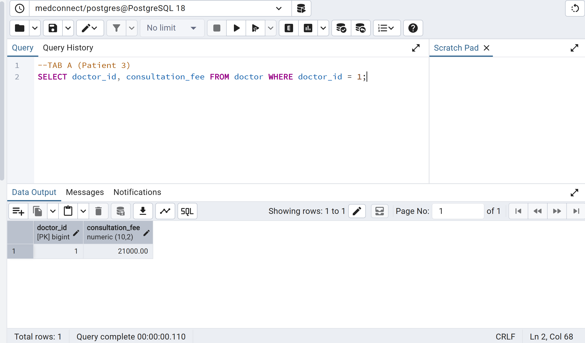
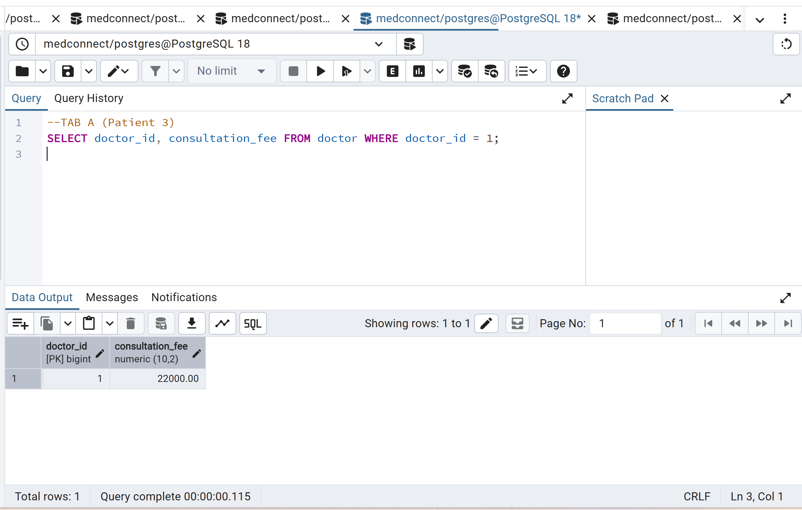

**Part 2: REPEATABLE READ.** Tab A starts with `BEGIN ISOLATION LEVEL REPEATABLE READ` and reads 22,000.00. Tab B again adds 1,000 and commits. Tab A's second read still returns 22,000.00, because the transaction keeps working from the snapshot taken at its first query. Only after Tab A commits does a new read show 23,000.00.

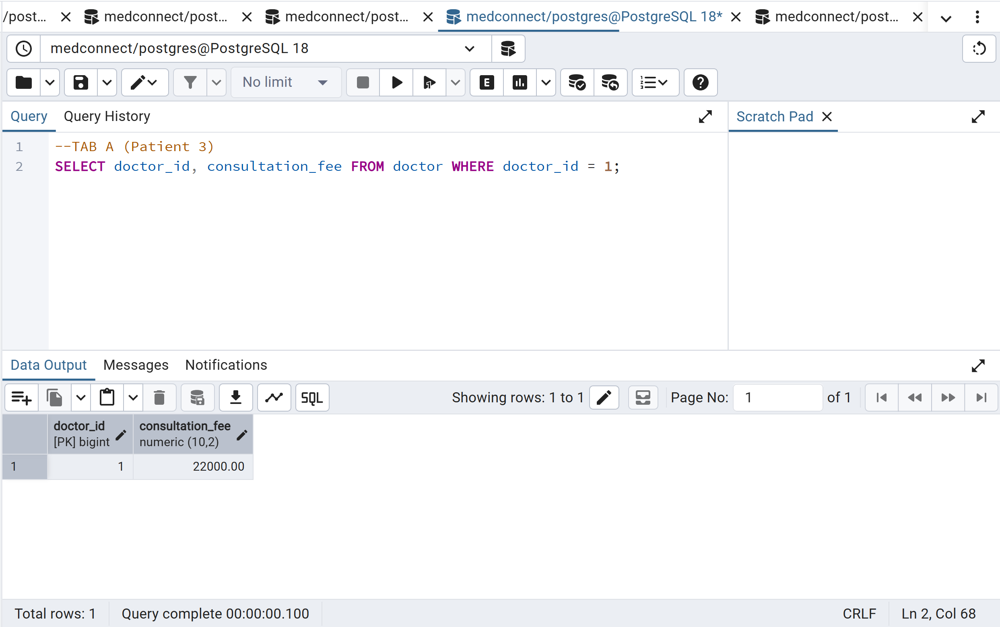
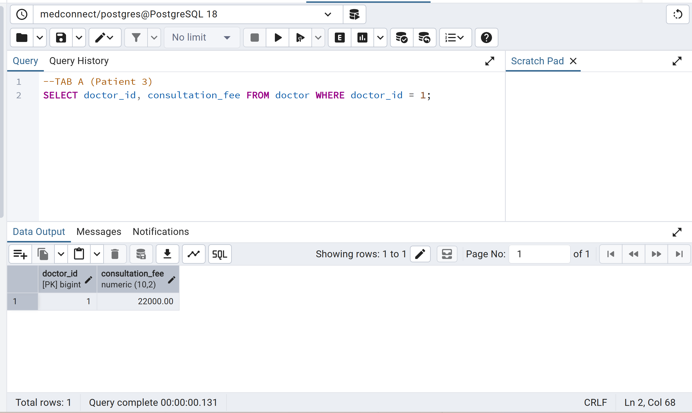
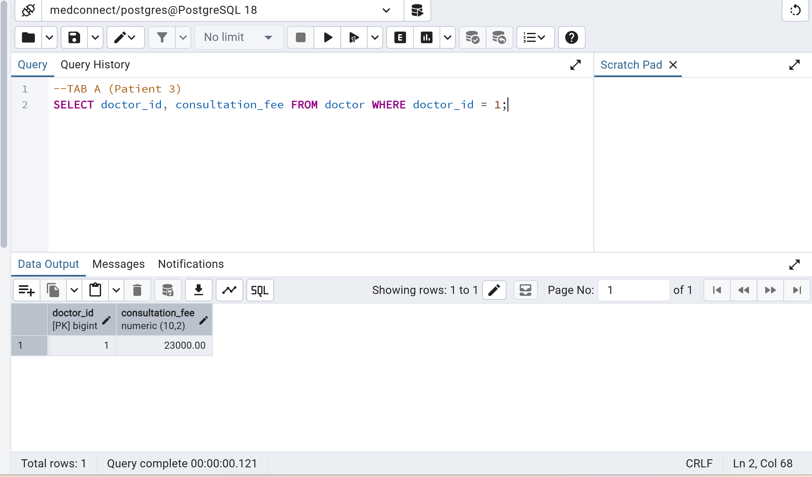

**Clean-up:** The script ends by restoring doctor 1's fee to 21,000 so the level can be repeated.

**Trade-off:** `REPEATABLE READ` gives a consistent view for reports and multi-step reads. The cost is that the transaction works with slightly stale data, and in PostgreSQL it can fail with a serialization error if it tries to update a row that another session changed. `READ COMMITTED` always sees the latest committed data, but results can change mid-transaction.

## Key Lessons
- **Atomicity:** A booking changes three tables, so it must be one transaction. `COMMIT` saves all the changes together and `ROLLBACK` undoes all of them, so the data never ends up half-saved.
- **Constraints are a safety net:** The `CHECK` constraint on payment method caused the failure in ROLLBACK, and the unique constraint on `consultation.slot_id` stopped the double booking in Race condition.
- **Check-then-act is not safe:** Reading "is the slot free?" and then booking it are two separate steps, so another session can slip in between them (race condition).
- **Row locking fixes it:** `SELECT ... FOR UPDATE` makes the second session wait, and it then sees the slot as taken and stops cleanly (fixing the race with SELECT).
- **Isolation level changes what you see:** `READ COMMITTED` can return different values inside one transaction, while `REPEATABLE READ` keeps one consistent snapshot (isolation level).

## How to Run
**Requirements:** PostgreSQL 18, pgAdmin 4, the `medconnect` database with the schema (Portfolio 1) and seed data (Portfolio 2) already loaded.

1. Open pgAdmin and connect to the `medconnect` database.
2. Open **Query Tool** and run each script in order: `01` to `05`.
3. For scripts `03`, `04` and `05`, open **two Query Tool tabs** (Tab A and Tab B). Run the commented sections in the order shown in the script, switching tabs where it says `TAB A` or `TAB B`.
4. Slots become booked after a demo, so running a script again on the same slot will fail. Before repeating a demo, pick a free slot ID and edit the slot ID in the script.
5. Script `05` changes doctor 1's fee, and its last statement restores it to 21,000.