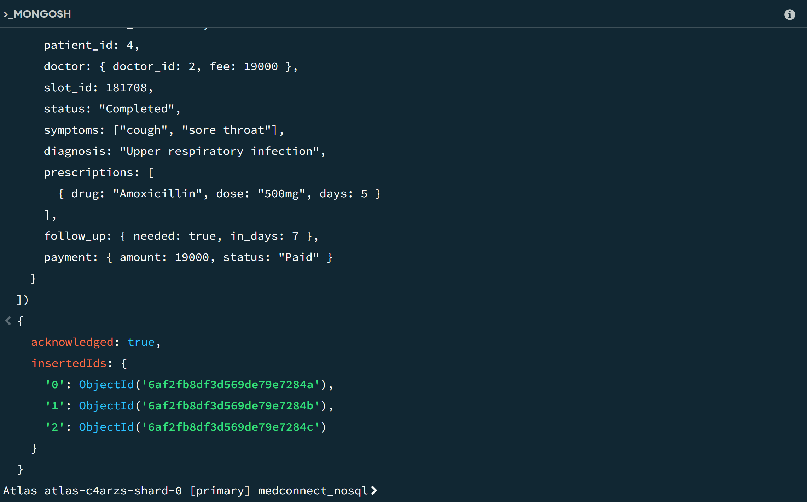
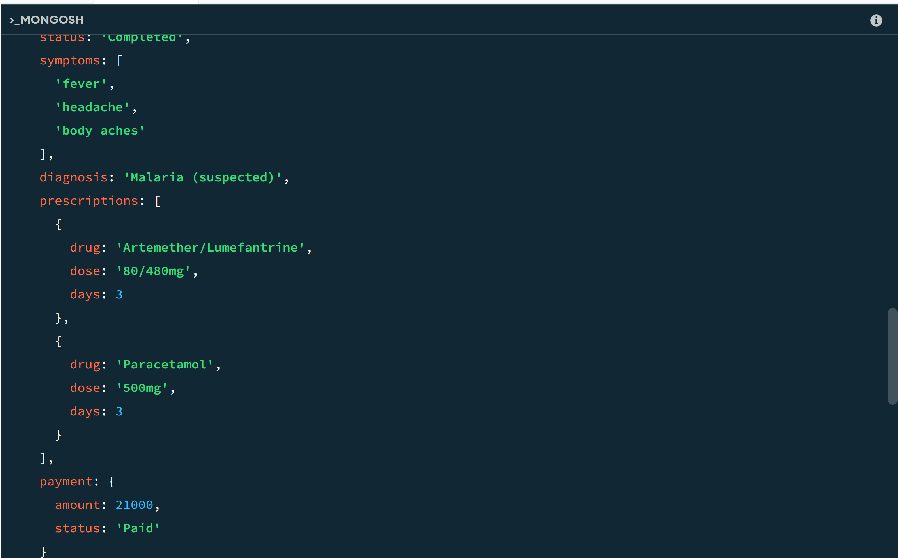
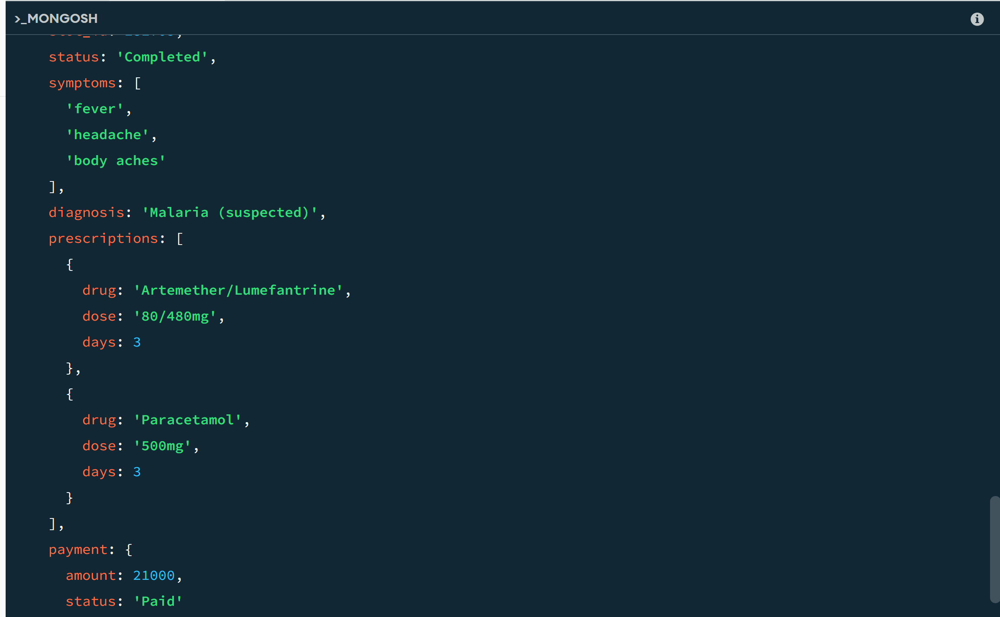
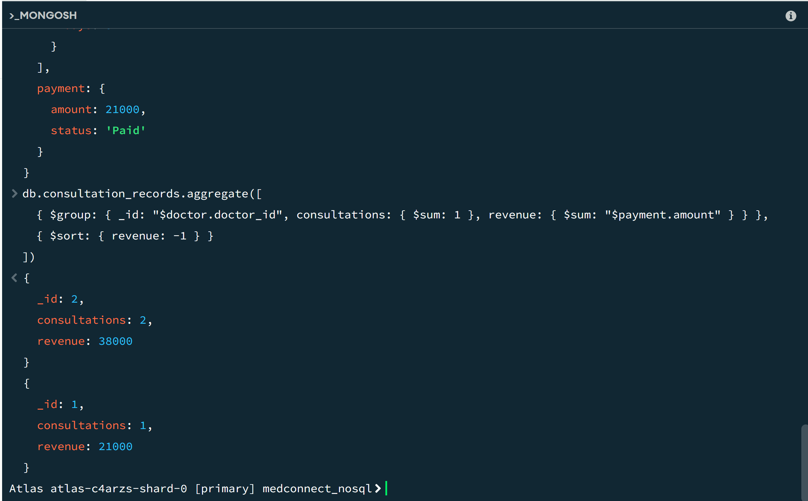

# Portfolio 4: NoSQL and Advanced Data Models

**Case study:** MedConnect (online healthcare and telemedicine platform, Nigeria), the same case study as Portfolios 1 to 3.
**Database:** MongoDB Atlas (free M0 cluster), document model. **Script:** `medconnect_mongo.js`

## Data model

In PostgreSQL (Portfolio 1), one consultation is spread across several tables (`consultation`, `payment`, and others) and rebuilt with joins. In MongoDB, each consultation is stored as **one document** in the `consultation_records` collection. It embeds the doctor, the payment, the symptoms and the prescriptions.

```json
{
  "consultation_id": 119540, "patient_id": 3,
  "doctor": { "doctor_id": 1, "fee": 21000 },
  "symptoms": ["fever", "headache", "body aches"],
  "diagnosis": "Malaria (suspected)",
  "prescriptions": [ { "drug": "Paracetamol", "dose": "500mg", "days": 3 } ],
  "payment": { "amount": 21000, "status": "Paid" }
}
```

## Implementation evidence

**1. Insert three consultation documents.**



**2. Read a patient's full consultation with no joins** (`find({ patient_id: 3 })`). One read returns the doctor, payment, symptoms and prescriptions.



**3. Search inside an array** (`find({ symptoms: "fever" })`).



**4. Aggregation pipeline:** consultations and revenue per doctor, using `$group` and `$sort`.



## Why a document database suits this data

- **Flexible structure:** Consultations differ. Some have a diagnosis, prescriptions or a follow-up, and some don't. Documents can have different fields without schema changes, while PostgreSQL would need extra columns or tables.
- **Fast reads:** A doctor or patient usually opens a whole consultation at once, so storing it together avoids joins.
- **Arrays and nested data:** Symptoms and prescriptions are lists, which fit naturally inside a document.

## Trade-offs

- **Duplicated data:** The doctor's fee is copied into each document. If the fee changes, old documents keep the old value (this is useful as a historical record, but it is not automatically kept in sync).
- **Weaker relational guarantees:** There are no foreign keys or `CHECK` constraints like in PostgreSQL, so transactions on bookings and payments (Portfolio 3) stay in PostgreSQL.
- **Best use:** PostgreSQL for bookings and payments (strict consistency), MongoDB for flexible clinical records and read-heavy views.

## How to run

1. Create a free MongoDB Atlas cluster and connect with MongoDB Compass.
2. Open the MongoDB shell in Compass.
3. Run the commands in `medconnect_mongo.js` one at a time.