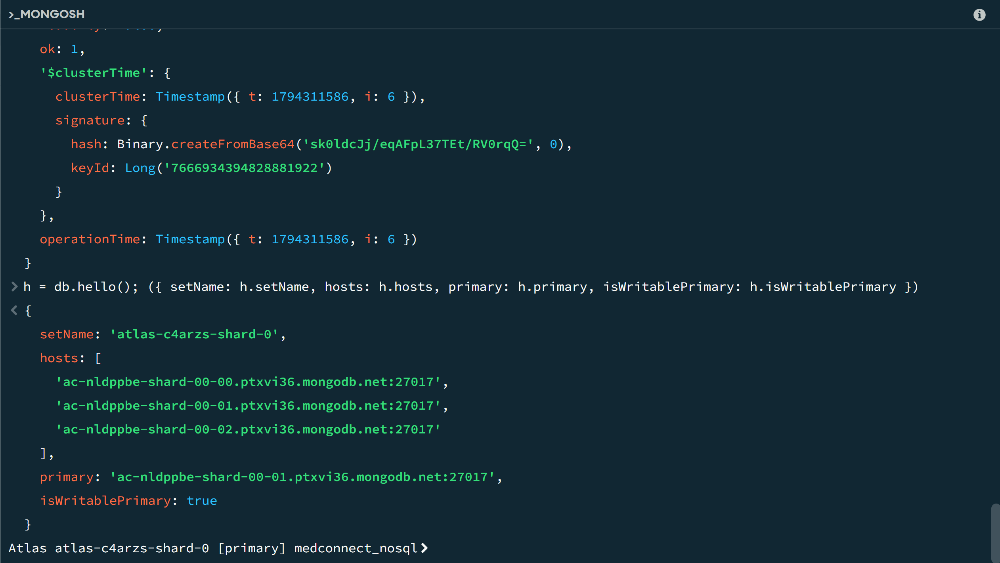
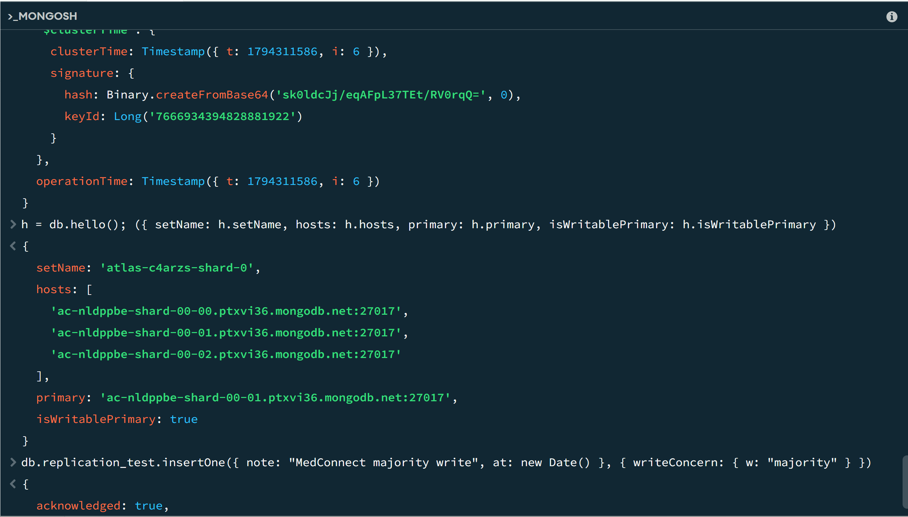
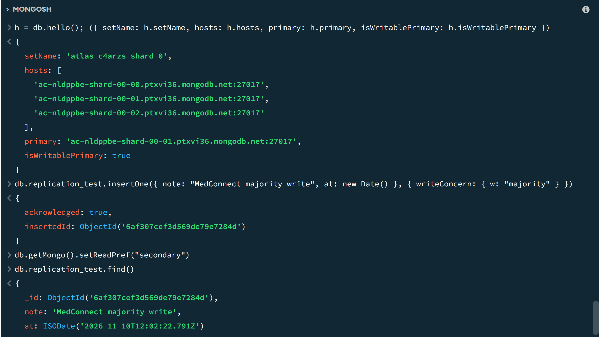

# Portfolio 5: Distributed and Cloud Database Exercise

**Case study:** MedConnect (online healthcare and telemedicine platform).

**Platform:** MongoDB Atlas. 

 **Script:** `replica_set_demo.js`

## 1. Cloud deployment

The MedConnect clinical records from Portfolio 4 run on a MongoDB Atlas cluster, so the data is hosted in the cloud and not on a single laptop. Atlas runs the cluster as a **replica set** with three servers.

## 2. Replication (evidence)

`db.hello()` shows a replica set named `atlas-c4arzs-shard-0` with three servers. One is the **primary**, which accepts all writes. The other two are **secondaries**, which keep copies of the data.

## 3. Consistency (evidence)

A write with `w: "majority"` is only confirmed after most of the three servers have stored it, so it survives the loss of one server. The test document was then read from a secondary, which returned the same data.

Reading from a secondary can briefly return slightly older data than the primary, because copying takes a moment. This is called eventual consistency. For MedConnect, I would read from the primary for bookings and payments, and allow secondary reads for less critical views such as consultation history.

## 4. Availability

If the primary server fails, the two remaining servers hold an election and one of them becomes the new primary, usually within seconds. Three servers are used because an election needs a majority (2 of 3). I did not simulate a failure in this exercise, so this point is a discussion, not an experiment.

## 5. CAP theorem

During a network partition, a distributed database must choose between consistency and availability. A MongoDB replica set favours **consistency**: if a server is cut off from the majority, it cannot become primary or accept writes, so patients could not book from that side until the partition is fixed. That trade-off is the right one for MedConnect, because a double-booked slot or a lost payment is worse than a short delay.

## 6. Sharding (design discussion)

Sharding splits a large collection across several servers so that no single server holds everything. The free Atlas tier does not support sharding, so this is a design only, and nothing was implemented.

- **Collection to shard:** `consultation_records`, the largest and fastest-growing collection.
- **Proposed shard key:** hashed `patient_id`. It spreads data evenly, and the most common query (all records for one patient) goes to a single shard.
- **Why not date as the key:** new consultations would all be written to the newest shard (a hotspot).
- **Trade-off:** Queries that don't include `patient_id`, such as revenue per doctor, must ask all the shards and combine the results.

## 7. How this fits with PostgreSQL

Bookings and payments stay in PostgreSQL (Portfolio 3), where transactions and constraints guarantee consistency. MongoDB holds the flexible clinical records, where replication and sharding help with scale and availability.

## How to run

Open the MongoDB shell in Compass and run the commands in `replica_set_demo.js` one at a time.